# Ruler

**Ruler** is a versioned business-rules engine. Business teams build **decision trees** and **expressions** in a
visual editor (Ruler Studio) and test them against a JSON input. Every rule is type-checked when it is saved,
approved by a second person against a sample input, and kept as an immutable version.

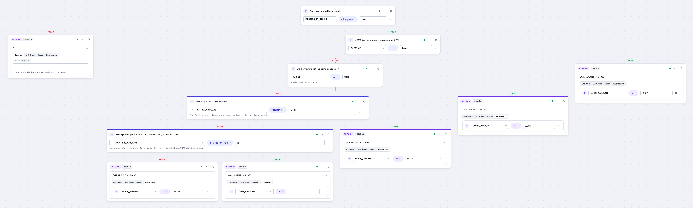

---

## Contents

- [Why Ruler](#why-ruler)
- [Ruler Studio](#ruler-studio)
- [Rule lifecycle](#rule-lifecycle)
- [Operators](#operators)

---

## Why Ruler

- **Rules as data, not code.** Rates, caps, concessions and eligibility checks change without a deploy.
- **Typed end to end.** Every attribute, constant and expression has a container type (`primitive`, `list`, `map`)
  and a data type (`integer`, `long`, `double`, `big_decimal`, `string`, `boolean`, `enum`, or your own). Type errors
  are caught when a rule is saved, not when it runs.
- **Maker–checker lifecycle.** `DRAFT → ACTIVE → INACTIVE`, with approve / reject / deactivate / reactivate. Approval
  replays a sample input to prove every attribute path exists with the right type.
- **Reusable expressions.** An expression is saved once (e.g. `base_value`) and referenced by pinned version from
  other expressions and from tree conditions.

---

## Ruler Studio

A React UI (in `ruler-example/ui`) for the whole rule lifecycle: list rules per case, build them visually, validate,
approve, reject, view history and test against the ACTIVE version.

The walkthrough below goes end to end: start a tree, add conditions, build and reuse expressions, then run the
rule against a sample input to see the result and the path it took.

### 1. Describe the tree

A new decision tree starts with its details: the **case** (which fixes the attributes available), a **name** (the
key becomes `<case>:<name>`), a description, and what it **returns**: a single value, a list or a map, plus the
data type. Every value in the tree must return that type. The **sample input** is required and is pre-filled from
the case's attribute paths. It is saved with every version, every attribute path the tree uses is checked against
it, and approval uses it by default.

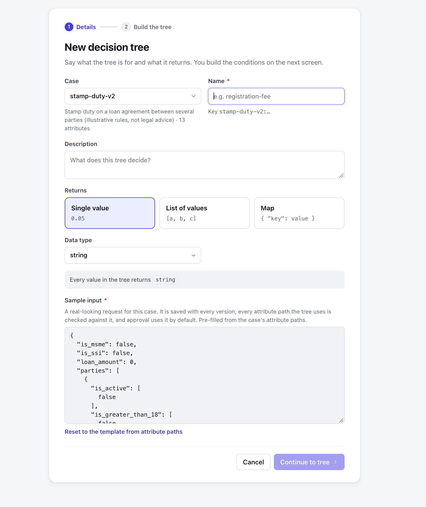

### 2. Start building

**Continue to tree** opens an empty canvas. The header shows the case and the return type, plus the toolbar used for the
rest of the flow: **Sample input**, **Calculate**, **Collapse all**, **Validate** and **Save as draft**. Start with a
**condition** (it splits into FALSE / TRUE) or a **value** (it ends a branch).


### 3. Add a condition

Each `IF` card reads as `left side · operator · right side`. Each side can be an **Attribute**, a **Constant** or an
**Expression**. The right side stays locked until the left side is picked, so the operator list and right-side type
always match the left side. The FALSE branch goes left and the TRUE branch goes right.

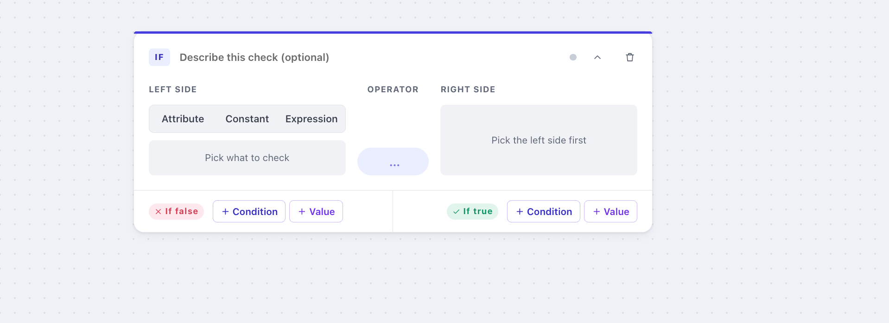

### 4. Fill it in

Pick the left side, and the matching operators and right-side type follow from it. Here a `list<string>` constant is
checked with `contains` against the `REQUEST_TYPE` attribute; the right side is locked to `single value · string`.
The green dot means the card has passed validation.

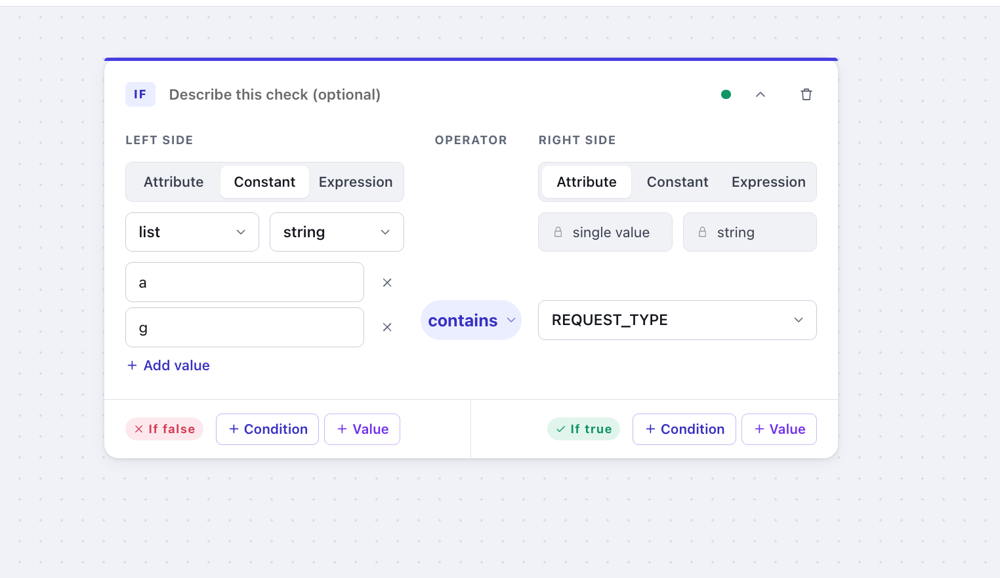

### 5. Grow the branches

Add a condition or a value under each branch. Every `RETURN` card must match the tree's return type (`string` here),
and its value can be a constant, an attribute, a saved expression or an inline expression.

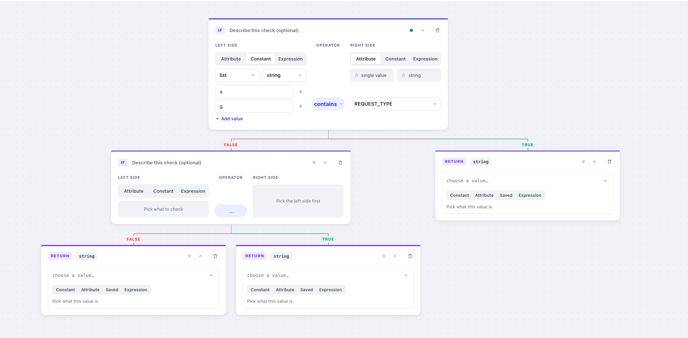

### 6. Build an expression

Expressions are built as a step-by-step ladder: each step is `operand · operator · (next step)`. This one computes
`base_value = 30% × (2 Cr + 20% × (LOAN_AMOUNT + 1 Cr))`.

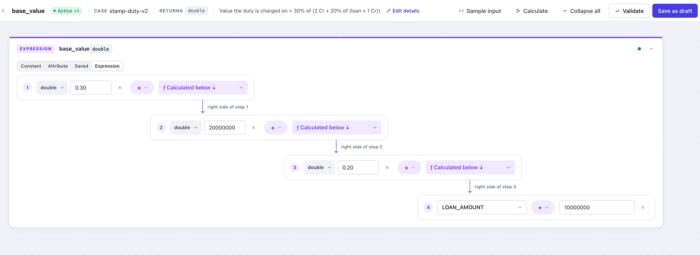

With a sample input loaded, every step shows its own working, so you can check the maths before saving:
`2,500,000 + 1 Cr = 12,500,000 → × 0.2 = 2,500,000 → + 2 Cr = 22,500,000 → × 0.3 = 6,750,000`. The result panel also
lists the attribute values the rule used.

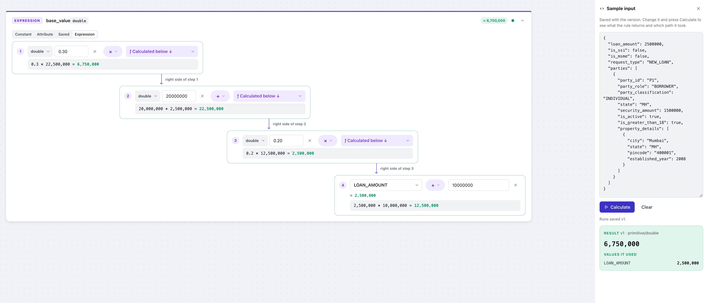

### 7. Reuse a saved expression

A saved expression can be used inside another one. Here `duty_at_half_percent = 0.005 × base_value`, pinned to
`base_value v1`:

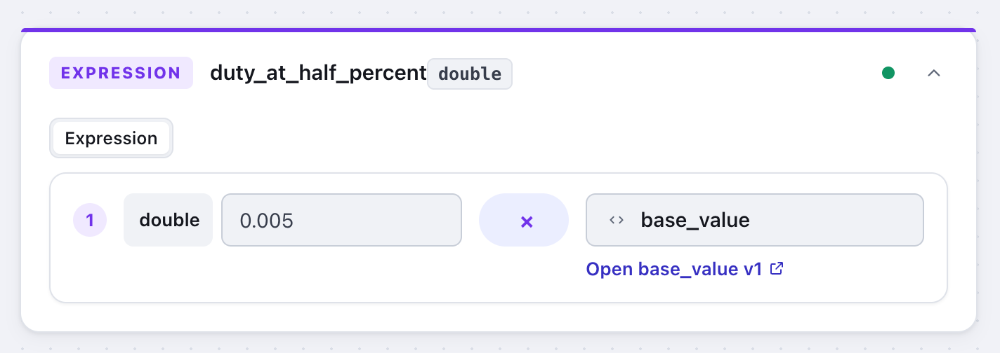

### 8. Use an expression in a condition

A condition can compare a saved expression with a constant or an attribute. This card implements a cap:
*if 0.5% of base_value ≥ 35000 then 35000, else 0.5% of base_value*.

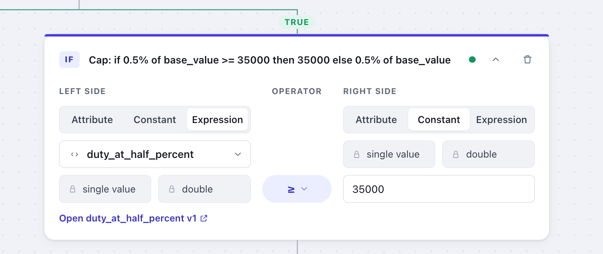

### 9. Calculate: see the output and the path taken

Open **Sample input**, edit the JSON if you like, and press **Calculate**. The tree highlights the branch that ran:
each condition shows its evaluated equation and verdict (`33,750 ≥ 35,000 → FALSE`), the card that returned the value
is marked **Returned**, and branches that did not run are greyed out. The panel shows the result, its type and the
attribute values it used. Edits to the sample input are only for trying values and are not saved.

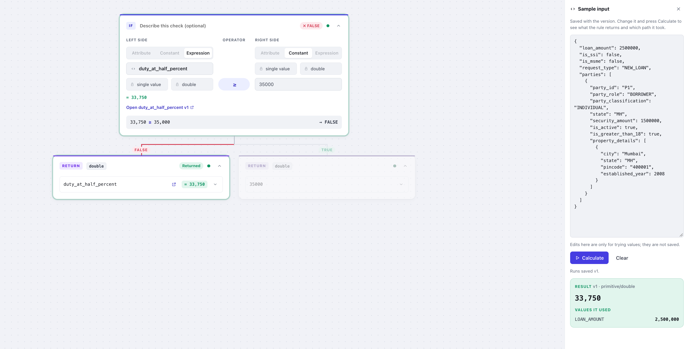

### 10. Review the whole tree

**Collapse all** shows the shape of the tree at a glance, with each card showing its description:

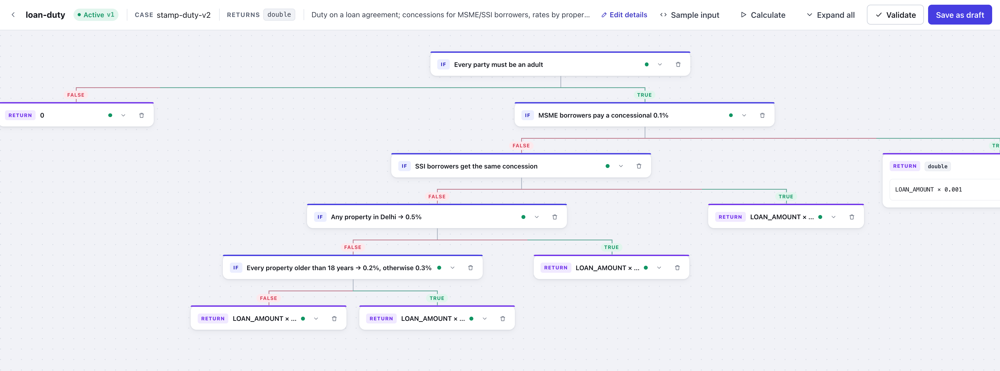

Expanded (the view at the top of this page), every condition reads as an equation and every value shows its
expression. Quantifier operators such as `all equals`, `all greater than` and `contains` work directly on list attributes.

When the tree is ready, **Validate** and **Save as draft**. A second person then approves it against the sample input
(see [Rule lifecycle](#rule-lifecycle)), and it becomes the ACTIVE version.


## Rule lifecycle

```
          create / update            approve (with sample input, by a reviewer)
  ───────────────────────▶ DRAFT ──────────────────────────────────────▶ ACTIVE
                             │                                             │
                    reject (remarks required)                      inactivate
                             ▼                                             ▼
                          INACTIVE ◀──────────────────────────────────── INACTIVE
                             │
                 reactivate → copied into a new DRAFT version
```

- Every save creates a new version as a DRAFT; earlier versions stay unchanged and are listed in the rule's history.
- A rule references a saved expression by a pinned version, which must be ACTIVE when the rule is saved.

---

## Operators

The operator list in each condition and expression step only offers operators that fit the selected types.

| Family | Operators |
|---|---|
| Comparison | `equals`, `not_equals`, `equals_ignore_case`, `in`, `prefix_match`, `suffix_match`, `GT`, `GTE`, `LT`, `LTE` (numbers) |
| List quantifiers | `all_equals`, `none_equals`, `all_greater_than`, `all_greater_than_or_equal`, `all_less_than`, `all_less_than_or_equal`, `any_greater_than`, `any_greater_than_or_equal`, `any_less_than`, `any_less_than_or_equal` |
| Collections | `contains`, `contains_all`, `contains_any`, `contains_key`, `contains_value`, `union`, `intersection`, `remove_all_if_exists` |
| Arithmetic | `add`, `subtract`, `multiply`, `divide`, `min`, `max`, `sum`, `add_all` |
| String | `upper_case`, `lower_case`, `append_prefix`, `append_suffix`, `remove_prefix_length`, `remove_suffix_length` |

Numbers are promoted `integer → long → double` and `integer/long → big_decimal`; mixing `double` and `big_decimal`
is a validation error, so precision is never lost silently.

---

Built by [Jatin Mishra](https://jatin-mishra.github.io/) · [LinkedIn](https://www.linkedin.com/in/jatin-mishra/)
